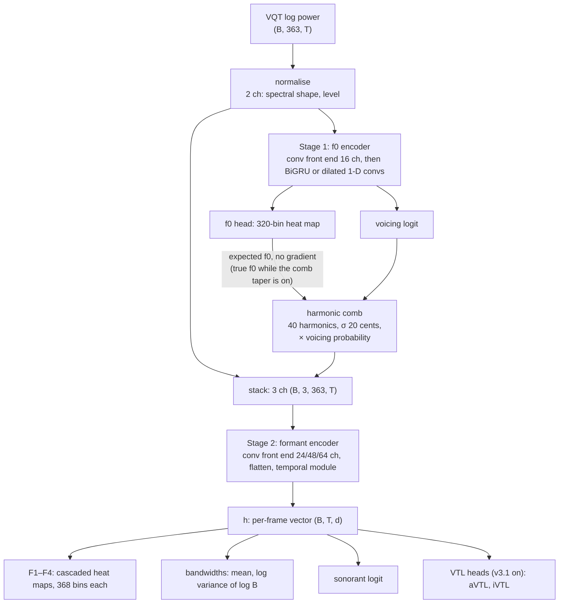
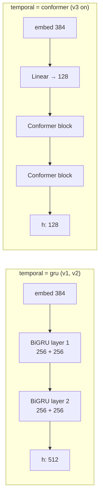
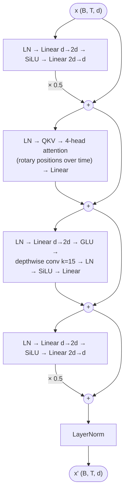
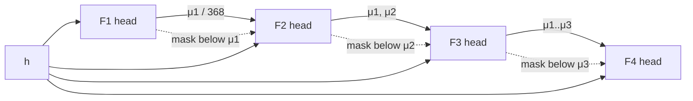
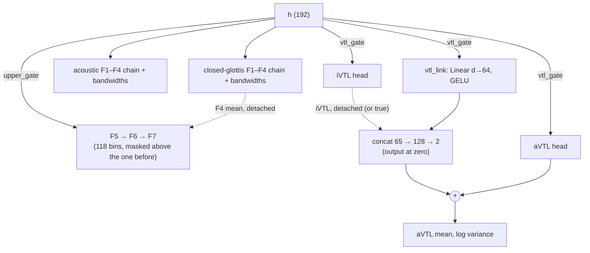
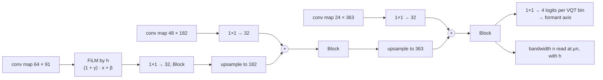
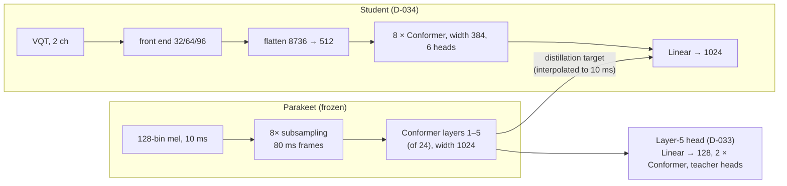

# Architectures

The network architectures tried so far: what each layer is, how wide, and how many parameters. Which run is which
model, and the exact weights, are in `models.md`; why each variant was tried and what it did are in `decisions.md`.
The code is `vocal_analysis/models/teacher.py` (every teacher variant, chosen by `TeacherConfig`) and
`scripts/parakeet/` (the Parakeet head and student). Parameter counts and map shapes come from
`scripts/analysis/arch_params.py`, which builds each configuration on the CPU (2026-11-11).

Notation: B batch, T frames (10 ms), F frequency bins, C channels, d the width of the per-frame vector h.

## Contents

- [Input and output axes](#input-and-output-axes)
- [The two-stage teacher](#the-two-stage-teacher)
- [Convolutional front end](#convolutional-front-end)
- [Temporal modules: BiGRU, Conformer, dilated convolutions](#temporal-modules)
- [Output heads](#output-heads)
- [Sizes](#sizes)
- [Read-out and trunk variants](#read-out-and-trunk-variants)
- [Parakeet head, student and probe heads](#parakeet-head-student-and-probe-heads)
- [Non-neural and external baselines](#non-neural-and-external-baselines)

## Input and output axes

- **Input**: VQT log power, 16 kHz audio, hop 160 samples (10 ms), 40–7500 Hz at 48 bins per octave: **363 bins**,
  windows up to 1280 samples (80 ms) (`features/vqt.py`). `normalise` turns it into 2 channels: the per-frame
  spectral shape (dB below the frame's peak, / 20, floored at -5) and the frame level ((peak + 40) / 30, the same at
  every bin).
- **Outputs** are heat maps over log-frequency axes at 20 cents per bin (`models/bins.py`), trained against
  Gaussian targets (σ 35 cents) and decoded by a local mean around the mode:

| Axis | Range | Bins | Used by |
|---|---|---|---|
| `F0_AXIS` | 40–1594 Hz | 320 | f0 |
| `FORMANT_AXIS` | 100–6938 Hz | 368 | F1–F4 |
| `UPPER_AXIS` | 2000–7740 Hz | 118 | F5 and up (D-090, D-085) |

Bandwidths are regressed (mean and log variance of log B per formant), not heat maps.

## The two-stage teacher

Every teacher has the same two stages (plan §7.2). Stage 1 reads the VQT and predicts f0 and voicing. A harmonic
comb is drawn from that f0 (no gradient) and stacked onto the VQT as a third channel. Stage 2 reads all three channels
and predicts the formants, bandwidths, sonorant probability and, from v3.1, vocal-tract length.

## Convolutional front end

Both stages start with a 2-D convolution stack over (frequency, time) that keeps **full frequency resolution first**
and halves it only later. Native convolutions dominate step time on this GPU (D-002), so channels at full
resolution are kept small.

- **Block** (residual): Conv2d 3×3, dilated **along frequency only** (dilation (r, 1)), GroupNorm(8), GELU, added
  to a skip (identity, or a 1×1 conv where the channel count changes).
- **Down** (not residual): Conv2d (3, 1), stride 2 along frequency only, GroupNorm(8), GELU.
- Then **flatten** channels × bins per frame, Linear to the embedding, GELU.

Each Block's 3×3 kernel spans ±1 frame, so the stage-2 stack sees ±9 frames (90 ms) and the f0 stack ±5 frames
before the temporal module. The frequency dilations widen the reach along frequency: at stage 2's last
resolution one bin is 4 VQT bins (1/12 octave).

Formant encoder (full size; S2 in brackets):

| Step | Channels | Bins | Dilations along frequency |
|---|---|---|---|
| input | 3 (comb on) | 363 | |
| Blocks × 3 | 24 (8) | 363 | 1, 2, 4 |
| Down | 48 (16) | 182 | stride 2 |
| Blocks × 4 | 48 (16) | 182 | 1, 2, 4, 8 |
| Down | 64 (32) | 91 | stride 2 |
| Blocks × 2 | 64 (32) | 91 | 1, 2 |
| flatten + Linear + GELU | 5824 (2912) → embed 384 (192) | | |

f0 encoder: 2 input channels; Blocks × 3 at 16 (8) channels and 363 bins (dilations 1, 2, 4); Down to 182 bins;
Blocks × 2 (dilations 1, 2); flatten 2912 (1456) → 256, GELU.

**Where the parameters are.** The flatten is the largest single layer in every teacher: in v3 it is 2.24 M of
4.10 M (55 %), and the f0 branch's flatten is another 0.75 M. All the convolutions together are 0.19 M. Everything the
heads know about frequency passes through this one non-residual projection to 384 and then 128 numbers per frame,
which is why D-054, D-056, D-072 and D-073 tried read-outs and side paths around it (see below).

## Temporal modules: BiGRU, Conformer, dilated convolutions

`TeacherConfig.temporal` picks the temporal module of **both** stages together.

| `temporal` | Formant encoder | f0 encoder | Models |
|---|---|---|---|
| `gru` | BiGRU, 2 layers, 256 per direction → h of 512 | BiGRU, 1 layer, 128 per direction → 256 | teacher v1, v2; S2 GRU (96 and 64 per direction) |
| `conformer` | Linear 384 → 128, then 2 Conformer blocks, width 128 → h of 128 | Linear 256 → 128, then 6 residual dilated 1-D convs, width 128 | teacher v3, v3.1, labeller v3, every S2 run from D-025 on |

The change (D-021 item 1, adopted with M3 in D-025) was for speed and streaming: the BiGRU is sequential (D-021
estimated it at about 45 % of CPU inference at 4 threads), and chunked attention could stream where a BiGRU cannot. It also shrank the model,
from 6.5 M to 4.1 M parameters, mainly by narrowing h from 512 to 128.

### Conformer block

Gulati et al. (2020), in the macaron form, with LayerNorm everywhere (the convolution module's BatchNorm too, so
nothing depends on batch size) and no dropout. The **residual stream** is d wide: 128 in v3 and v3.1 (and S2), 192
in D-085, 384 in the student, 128 in the Parakeet head. Each block ends with a LayerNorm on the stream.

- Feed-forward ×½: LayerNorm, Linear d → 2d (`ff_mult` 2), SiLU, Linear 2d → d.
- Self-attention: LayerNorm, one Linear to Q, K, V, **4 heads** (32 wide at d = 128), rotary positions over time
  (attention depends only on relative position, so any crop length works, which D-085's 16 s crops rely on), full
  bidirectional attention, output Linear d → d.
- Convolution module: LayerNorm, Linear d → 2d, GLU, depthwise Conv1d over time (**kernel 15**, ±7 frames),
  LayerNorm, SiLU, Linear d → d.
- Feed-forward ×½ again, then LayerNorm.

### Dilated 1-D convolutions (the f0 branch of Conformer models)

Six residual layers at width 128: depthwise Conv1d (kernel 3, dilation 1, 2, 4, 8, 16, 32), pointwise Conv1d,
GroupNorm(8), GELU, added to the input. Receptive field ±63 frames (0.63 s), with no attention.

## Output heads

All heads read h per frame.

| Head | Form | Output |
|---|---|---|
| f0 | Linear (f0 branch width → 320) | f0 heat map |
| voicing | Linear → 1 | logit |
| F1–F4 (`formant_heads`) | head n: Linear (d + n → 368); its inputs are h and the expected bins of heads < n, / 368 | 4 heat maps, cascaded and masked |
| bandwidths (`bw_head`) | Linear d → 8 | mean (+4.5) and log variance of log B per formant |
| sonorant | Linear → 1 | logit |
| aVTL (`vtl_head`, D-036; in v3.1) | LayerNorm, Linear d → 256, GELU, Linear 256 → 256, GELU, Linear → 2, behind a gradient gate | mean and log variance of log2 length (cm) |
| iVTL (`vtl_inst_head`, D-051; in D-085) | as aVTL, the same gate | instantaneous length, with larynx height and lip protrusion |

**The formant cascade.** Head n sees the expected positions of heads 1…n−1 and is softly pushed above head n−1:
its logits lose 8 · tanh(max(0, μₙ₋₁ − 10 − k) / 10) at bin k, so bins more than 200 cents below the previous
formant are suppressed. D-084 found the heads ignore the fed means (an input of bin / 368 has no leverage beside h)
and only the mask acts.

**Gradient gates** (`_GradGate`: the identity forward, the gradient scaled by α backward): the VTL heads
(`vtl_gate`), the opening head (`opening_gate`) and the upper-formant heads (`upper_gate`) read h through one, so
the trainer can grow how much each head shapes the trunk (0 = a probe on a frozen trunk, 1 = fully joint).

## Sizes

| Model | Front end (formant / f0 channels) | Embed | Temporal (formant / f0) | h (d) | Params | Used for |
|---|---|---|---|---|---|---|
| **full GRU** | 24/48/64 / 16 | 384 | BiGRU 2 × 256 / BiGRU 1 × 128 | 512 | 6.49 M | teacher v1, v2 |
| **S2 GRU** | 8/16/32 / 8 | 192 | BiGRU 2 × 96 / BiGRU 1 × 64 | 192 | 1.75 M | fast proxy (D-024) |
| **full Conformer** | 24/48/64 / 16 | 384 | Conformer 2 × 128, 4 heads / dilated convs 128 | 128 | 4.10 M | teacher v3, labeller v3 |
| **v3.1** | as full Conformer, + aVTL head | 384 | as full Conformer | 128 | 4.20 M | teacher v3.1 (current) |
| **S2 Conformer** | 8/16/32 / 8 | 192 | Conformer 2 × 128, 4 heads / dilated convs 128 | 128 | 1.87 M | fast proxy from D-025 |
| **D-085 base** | 24/48/64 / 16 | 576 | Conformer 2 × 192, 4 heads (48 wide), FF 384 / dilated convs 128 | 192 | 6.22 M | D-085 screening (training) |
| **D-085 heads** | as base, + heads bundle | 576 | as base | 192 | 6.60 M | D-085 screening (training) |

S2's temporal module keeps the full model's width (128), so only its front end, embedding and f0 branch shrink.

Parameters by part (thousands):

| Model | f0 branch | Formant convs | Flatten → embed | Temporal | Heads |
|---|---|---|---|---|---|
| full GRU | 1053 | 182 | 2237 | 2169 | 844 |
| full Conformer (v3) | 893 | 182 | 2237 | 551 | 235 |
| v3.1 | 893 | 182 | 2237 | 551 | 334 |
| S2 Conformer | 512 | 32 | 559 | 527 | 235 |
| D-085 base | 893 | 182 | 3355 | 1232 | 562 |
| D-085 heads | 893 | 182 | 3355 | 1232 | 939 |

(f0 branch is the f0 encoder; heads are every output layer, the f0 and voicing heads included.)

### D-085's arms

D-085 (registered 2026-11-08, training at the time of writing) widens the trunk about 1.5× (Conformer width
128 → 192, embedding 384 → 576) and trains on long crops (4–16 s) as well. Both arms add the iVTL head. The heads arm
adds, on the same h:

- **acoustic heads** (`acoustic_heads`): a second F1–F4 chain and bandwidth head, the flat read-out's form with its
  own fed means, trained on acoustic (glottis-coupled) labels beside the closed-glottis set;
- **upper heads** (`n_upper` 3): F5–F7 on `UPPER_AXIS`, Linear d → 118 each, each masked above the one before (F5
  above F4's mean, detached), behind `upper_gate`;
- **VTL link** (`vtl_link`): the aVTL head also reads the instantaneous length (log2 cm, detached; the true one when
  fed): a 64-wide projection of h plus that length → 128 → GELU → 2, its output layer at zero, added to the aVTL
  head's output.

## Read-out and trunk variants

Each was tried one change at a time, on v3.1's trunk (frozen first, or in a decay branch) except D-027 (S2). None is
in the current teacher. Parameter counts are each variant added to v3.1.

| Variant (`TeacherConfig`) | What changes | Params (v3.1 = 4.20 M) | Decision | Outcome |
|---|---|---|---|---|
| `obs_head` | Linear (d + 4 → 4): a per-formant observability logit from h and the formants' positions (no gradient into them) | 4.20 M | D-027 (on S2) | no harm, but did not learn its label (Spearman below 0.8 at F3, F4); built, off; M4 gates on the decoded σ instead |
| `readout="mlp"` | the formant and bandwidth heads get one hidden layer of 512 (a capacity control) | 5.10 M | D-054, D-073 | control arm only |
| `readout="film"` | `FreqReadout`: per-bin read-out (below), in place of the flat heads | 4.10 M | D-054 | futility stop |
| `readout="film_residual"` | the flat heads plus `FreqReadout`, its output layers at zero | 4.29 M | D-056 | non-inferior, no gain |
| `readout="queries"` / `"queries_abs"` | `QueryReadout`: learned formant queries score `FreqReadout`'s maps (content-only keys, or with absolute bin positions) | 4.12 / 4.13 M | D-073 | neither supported (queries 1.67× the MLP's MAE) |
| `proj_side="retrieve"` / `"factorised"` | a path beside the flatten (below), output at zero | 4.41 / 4.42 M | D-072 | lands on 5b to the decimal |
| `opening_head` | the aVTL head's form → sigmoid: the frame's mean glottal opening, behind `opening_gate` | 4.30 M | D-080 | learned only as an Rd proxy; guards failed |
| `fed_standardised` | the chain's fed means also enter as (bin − centre) / 30 through a fresh Linear per head, at zero | 4.20 M | D-086 | no gain on either seed |
| `n_upper` | F5–F7 heads (as in D-085) | 4.24 M | D-090 | non-inferior, no gain |
| `vtl_inst_head` | iVTL head | 4.30 M | D-051 | 5b kept (length reliability failed); in D-085's base |

### Frequency-resolved read-out (D-054, D-056, D-073)

`FreqReadout` bypasses the flatten for the heads: it takes the conv maps at each resolution (kept by the encoder),
FiLM-modulates the coarsest (64 × 91) by h (a scale and shift per channel and frame), and upsamples it U-Net style,
adding the finer maps through 1×1 convs with a residual Block (32 channels) at each resolution. A 1×1 conv then gives
one logit per VQT bin per formant, interpolated onto the formant axis. Bandwidth n is read from the full-resolution
features at formant n's expected position (detached), concatenated with h, through 64 → 2.

`QueryReadout` replaces the final 1×1 conv: formant n's query is a learned 32-d vector plus a projection of h, the
four queries pass through one self-attention layer (4 heads), and each scores every bin by a dot product with the
bin's key (a 1×1 projection of the maps, plus a learned position per bin in the `_abs` arm).

### Side paths beside the flatten (D-072)

`ProjSide` adds a path from the last conv map (64 × 91) to the embedding, after the flatten's GELU, its output layer
at zero: **retrieve**: 8 learned queries (64-d) cross-attend over the 91 bins, with a learned absolute position per
bin in the keys; **factorised**: one Linear shared across channels compresses each channel's 91 bins to 9, then a
Linear mixes them.

## Parakeet head, student and probe heads

### Parakeet TDT 0.6B v3's encoder (frozen, D-033)

NVIDIA's ASR encoder (CC BY 4.0, loaded from local safetensors): 128-bin mel input at 10 ms, 8× subsampling by
convolutions (256 channels, stride 2 three times) to **80 ms frames**, then **24 Conformer layers**, width 1024,
8 heads, feed-forward 4096, convolution kernel 9, SiLU. D-033's layer probe found layer 5 best for formants and
bandwidths, so only layers 1–5 are run.

### Head on layer 5 (D-033 part 2)

0.87 M trainable parameters: LayerNorm(1024), Linear 1024 → 128, linear interpolation in time from 80 ms to our
10 ms frames, 2 Conformer blocks (width 128, the teacher's block), then the teacher's own heads (f0, voicing,
cascaded F1–F4, bandwidths, sonorant), so `decode_outputs` reads it like a teacher.

### Student (D-034)

Distils Parakeet's layer 5 into our front end, so the features can be had without Parakeet: the formant encoder
without the comb (2 input channels), scaled up. **32.7 M parameters**, 27.5 M of them in the Conformer.

| Part | Size |
|---|---|
| conv front end | 32 / 64 / 96 channels (same stages and dilations as the teacher) |
| flatten | 96 × 91 = 8736 → 512 |
| temporal | Linear 512 → 384; **8 Conformer blocks**, width 384, **6 heads** (64 wide), feed-forward ×4 (1536), kernel 15 |
| output | Linear 384 → 1024 (Parakeet's width), at 10 ms frames |

### Probe and fusion heads on frozen features

- **VTL probe head** (D-035): LayerNorm, Linear (in → 256), GELU, Linear 256 → 256, GELU, Linear → 2 (mean and log
  variance of log2 length), on frozen teacher features (128-d, 10 ms) or Parakeet layer 5 (1024-d, 80 ms). The same
  module became the joint `vtl_head` (D-036), index-compatible with these weights.
- **Fusion** (D-039, exploratory): *early*: LayerNorm on each of teacher (128) and Parakeet (1024) features,
  concatenated with two presence flags → 256 → 256 → 2; *penultimate*: the two D-035 heads' frozen 256-d hidden
  layers, concatenated with the flags → 256 → 2.
- **Extra-input formant heads** (D-038): the trunk's formant heads with zero-initialised Linear inputs for the
  predicted VTL (log2 cm or 1/L) and its uncertainty.

## Non-neural and external baselines

`vocal_analysis/baselines/`: formants by Praat (defaults, and a FastTrack-style multi-ceiling sweep), TVLP and QCP-FB;
f0 by PESTO and CREPE (torchcrepe). The external f0 models were trained on MIR-1K (and CREPE also on MDB-stem-synth),
which are our evaluation sets, so that overlap is reported beside their scores.
